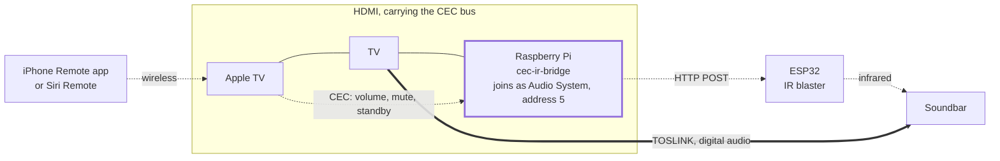

# cec-ir-bridge

[](https://github.com/mjaksn/cec-ir-bridge/actions/workflows/ci.yml)
[](https://github.com/mjaksn/cec-ir-bridge/releases/latest)
[](https://github.com/mjaksn/cec-ir-bridge/blob/main/LICENSE)

Control a legacy IR-only soundbar from the Apple TV Remote app on your
iPhone, without giving up a digital (TOSLINK) audio path.

A Raspberry Pi plugged into any spare HDMI input on the TV registers on
the HDMI-CEC bus as an **Audio System**. When the Apple TV sees an audio
system on the bus, the volume buttons in the iPhone Remote app (and on
the Siri Remote) come alive and send CEC volume/mute commands to it.
This bridge receives those commands and fires HTTP requests at an
ESP32-based IR blaster, which transmits the soundbar's IR codes.

Audio never touches the Pi. It keeps flowing Apple TV -> HDMI -> TV ->
TOSLINK -> soundbar, so it stays digital the whole way.



Solid lines are cables, and there are only two: the HDMI runs that put
the Pi on the same bus as the Apple TV. Dotted lines have no cable of
their own, and together they trace the whole control path, from the
remote over the air, through the CEC frames riding the HDMI wiring, to
the HTTP call and the infrared across the room. The thick line is the
audio, on its own optical cable from the TV's digital audio output to
the soundbar. It reaches the TV from the Apple TV over the same HDMI
run, and never touches the Pi.

Note what the Pi is not plugged into. It has no connection to the Apple
TV and none to the soundbar, and it never becomes the active source on
the TV. It sits on the shared CEC bus, answers to the address an audio
system would answer to, and turns what it hears there into HTTP.

## Hardware

- Raspberry Pi with a free HDMI port on the TV. The Pi's HDMI port has
  native CEC support, so no adapter hardware is needed, and the bridge
  asks very little of the board: a Zero 2 W is plenty, and an old Pi 2 B
  works just as well
- A network path from the Pi to the ESP32. A model without Wi-Fi, such
  as the Pi 2 B, needs Ethernet or a USB Wi-Fi dongle
- ESP32 (or similar) with an IR transmitter, running firmware that
  exposes HTTP endpoints which transmit your soundbar's volume up,
  volume down, and mute IR codes. With ESPHome, name the buttons
  `volume_up`, `volume_down` and `mute` and the default paths work as
  they are;
  [`esphome/ir-blaster.yaml`](https://github.com/mjaksn/cec-ir-bridge/blob/main/esphome/ir-blaster.yaml)
  is a starting point (see Configure)
- An HDMI cable (plus an adapter for a Pi with a mini or micro HDMI
  port, such as a Zero)

The Pi only needs to join the CEC bus. Nothing has to "watch" its HDMI
input, and it needs no connection to the Apple TV or soundbar.

On a Pi 2 B, use the 32-bit Raspberry Pi OS image. The original v1.1
board cannot run the 64-bit one, and nothing here needs it. The bridge
is plain bash, so the install is otherwise identical.

## Install

On a fresh Raspberry Pi OS Lite (Trixie or Bookworm), from the latest
release:

```bash
curl -fsSL -o cec-ir-bridge.tar.gz https://github.com/mjaksn/cec-ir-bridge/releases/latest/download/cec-ir-bridge.tar.gz
tar -xzf cec-ir-bridge.tar.gz
cd cec-ir-bridge-*
sudo ./install.sh http://<esp32-ip-or-hostname>
```

Or from a clone, which is the same installer against whatever `main`
currently holds:

```bash
git clone https://github.com/mjaksn/cec-ir-bridge.git
cd cec-ir-bridge
sudo ./install.sh http://<esp32-ip-or-hostname>
```

The installer:

1. Installs `cec-utils`, `v4l-utils`, and `curl`
2. Writes `/etc/cec-ir-bridge.conf` (from `cec-ir-bridge.conf.example`;
   a re-install keeps every value already in it, `ESP32_BASE_URL`
   included, and only appends settings the example has gained, so to
   change the URL later, edit the file rather than re-running the
   installer with a new one)
3. Installs the bridge to `/usr/local/bin/cec-ir-bridge`
4. Adds `hdmi_ignore_cec=1` to `/boot/firmware/config.txt` (or
   `/boot/config.txt` on older images), unless that file already sets it
5. Installs, enables, and starts the `cec-ir-bridge` systemd service

Step 4 keeps the Pi's boot firmware off the CEC bus. Without it, the
firmware joins the bus by itself while the Pi starts up: it announces
itself as the active source, which switches the TV to the Pi's input,
and then vanishes when Linux takes over HDMI. A Sony Bravia was seen to
drop every CEC device it knew when that happened, the Apple TV
included. The bridge uses the kernel's CEC driver rather than the
firmware's, so it is unaffected. The setting takes effect after one
reboot. A line already in the file is left as it is, whatever its value,
so `hdmi_ignore_cec=0` puts the firmware back on the bus and survives a
re-install.

`hdmi_ignore_cec_init=1`, the setting usually suggested for the input
switching, is not enough on its own. It stops the active source message
but leaves the firmware on the bus, and the Bravia still dropped its
devices with it in place. If the TV still switches inputs after the
reboot, it is following the HDMI signal by itself; look for an automatic
input switching setting on the TV.

Then on the Apple TV: **Settings -> Remotes and Devices -> Volume
Control -> Auto**. Toggle the setting or restart the Apple TV once so it
re-scans the CEC bus and discovers the new "Soundbar" audio system. Make
sure the TV is on the first time you test, since the Pi cannot obtain a
CEC physical address until it reads EDID from the TV.

On the TV, set the sound output to the audio system rather than the TV
speakers if volume presses do nothing. A Sony Bravia needs this (its
speaker setting is called **Audio System**) before the Apple TV's volume
commands reach the bridge, and it can slip back to its speakers later on;
see [Keeping a Sony Bravia on Audio System](#keeping-a-sony-bravia-on-audio-system).

## Configure

Edit `/etc/cec-ir-bridge.conf`:

| Setting | Default | Purpose |
|---|---|---|
| `ESP32_BASE_URL` | (set at install) | Base URL of the IR blaster |
| `VOLUME_UP_PATH` | `/button/volume_up/press` | Endpoint for volume up IR |
| `VOLUME_DOWN_PATH` | `/button/volume_down/press` | Endpoint for volume down IR |
| `MUTE_PATH` | `/button/mute/press` | Endpoint for mute IR |
| `POWER_OFF_PATH` | empty (disabled) | Fired on CEC Standby, broadcast or sent to the Pi |
| `POWER_ON_PATH` | empty (disabled) | Fired on Image View On or Text View On, if the Pi receives one; a source normally sends these to the TV alone, so check with `cec-ctl --monitor` that they reach the Pi before relying on it |
| `MUTE_IGNORE_INITIATORS` | `0` (the TV) | Initiators whose mute commands are ignored |
| `VOLUME_IGNORE_INITIATORS` | empty | Initiators whose volume commands are ignored |
| `POWER_IGNORE_INITIATORS` | empty | Initiators whose power commands are ignored |
| `OSD_NAME` | `Soundbar` | Name shown to other CEC devices |
| `ENGINE` | `cec-client` | CEC backend, see below |

Apply changes with `sudo systemctl restart cec-ir-bridge`. To read
settings from another file instead, set `CEC_IR_BRIDGE_CONF` to its path
in the bridge's environment.

The default paths are ESPHome button endpoints for buttons named
`volume_up`, `volume_down` and `mute`. ESPHome 2026.7 and later address a
button by its name as written in the YAML; versions before 2026.1 used
an id derived from the name, and the ones in between accepted both. A
name already in that lowercase, underscored form is the same either way,
so those three names work with any version.
[`esphome/ir-blaster.yaml`](https://github.com/mjaksn/cec-ir-bridge/blob/main/esphome/ir-blaster.yaml)
is a minimal ESPHome configuration with the three buttons already named
that way, and comments on learning your soundbar's codes with an IR
receiver.

A button with any other name needs its path set to match, with spaces
written as `%20`. On a current ESPHome, one named `Volume Up` is
`/button/Volume%20Up/press`, and `/button/volume_up/press` answers `404`.

The optional power paths let the soundbar follow the rest of the system:
when the Apple TV puts everything to standby via CEC, the bridge can fire
the soundbar's power IR code too. Waking is less certain. Image View On
and Text View On are normally sent to the TV alone, so before relying on
`POWER_ON_PATH`, check with `cec-ctl --monitor` (see Debugging) that they
reach the Pi at all.

### Filtering by initiator

Every CEC frame carries the logical address of the device that sent it,
and the bridge decodes it so commands can be accepted from one device
and ignored from another. Addresses are given in decimal, comma or space
separated: `0` is the TV, `4`, `8`, and `11` are playback devices such as
an Apple TV, and `5` is the audio system.

This exists because some TVs emit a spurious mute when powering off and
send no matching unmute on power on. Since IR mute is usually a toggle
and the bridge has no feedback from the soundbar, that stray command
leaves the soundbar silently muted until someone notices. Ignoring mute
from the TV (the default) fixes it while keeping mute working from the
Apple TV. Ignored events still appear in the log, so filtering never
hides bus activity from you.

## CEC engines

Two backends are included:

- **`cec-client`** (default): libcec. The bridge parses raw TRAFFIC
  frames (for example `>> 05:44:41` is User Control Pressed, Volume Up),
  which is deterministic and avoids double-triggering on libcec's
  human-readable log lines.
- **`cec-ctl`**: the kernel CEC framework tool from `v4l-utils`. libcec
  is in maintenance mode and Raspberry Pi engineers point people toward
  the kernel API, so if `cec-client` cannot find the adapter on your
  image even though `/dev/cec0` exists, set `ENGINE="cec-ctl"` and restart
  the service. A missing `/dev/cec0` is a different fault, which neither
  engine gets around (see Debugging).

## Keeping a Sony Bravia on Audio System

A Bravia set to **Audio System** does not always stay there. Now and then
it falls back to its built-in speakers, and from then on the Apple TV's
volume presses stop reaching the bridge. The journal goes quiet rather
than showing an error, because no frames arrive.

Sony's remote codes include one that puts the output back. A Bravia
remote app that exposes the full IRCC button list shows it as **Audio
Output_Audio System**, and its IRCC code is `AAAAAgAAAMQAAAAiAw==`. Sent
while the TV is already on Audio System, it has shown no visible effect
at all: no flicker, no skip in the audio and nothing on screen. Sent
after the TV has slipped to its speakers, it switches the output back,
with a brief interruption while it does. That makes it safe to send
routinely, not only once something has gone wrong.

Sending it about five seconds after the TV turns on, and again about five
seconds after the TV switches to the Apple TV's input, has kept one Bravia
on Audio System since. The bridge does not send it; something that sees
those events has to, such as a home automation system.

There are two ways to send it, and both have behaved the same: over the
network to the TV's IP control interface, or as infrared from the ESP32
that already drives the soundbar.

### Over the network

The TV must have IP control enabled with a pre-shared key, and the key
goes in the `X-Auth-PSK` header. To send the button by hand:

```bash
curl -i -X POST "http://<tv-ip>/sony/ircc" \
  -H 'Content-Type: text/xml; charset=UTF-8' \
  -H 'SOAPAction: "urn:schemas-sony-com:service:IRCC:1#X_SendIRCC"' \
  -H 'X-Auth-PSK: <pre-shared-key>' \
  -d '<?xml version="1.0"?><s:Envelope xmlns:s="http://schemas.xmlsoap.org/soap/envelope/" s:encodingStyle="http://schemas.xmlsoap.org/soap/encoding/"><s:Body><u:X_SendIRCC xmlns:u="urn:schemas-sony-com:service:IRCC:1"><IRCCCode>AAAAAgAAAMQAAAAiAw==</IRCCCode></u:X_SendIRCC></s:Body></s:Envelope>'
```

The same call as a Home Assistant `rest_command`, for automations to run
on those two events:

```yaml
rest_command:
  set_sony_bravia_to_soundsystem_mode:
    url: "http://<tv-ip>/sony/ircc"
    method: POST
    timeout: 10
    content_type: "text/xml; charset=UTF-8"
    headers:
      SOAPAction: '"urn:schemas-sony-com:service:IRCC:1#X_SendIRCC"'
      X-Auth-PSK: !secret sony_tv_psk
    payload: >-
      <?xml version="1.0"?><s:Envelope xmlns:s="http://schemas.xmlsoap.org/soap/envelope/" s:encodingStyle="http://schemas.xmlsoap.org/soap/encoding/"><s:Body><u:X_SendIRCC xmlns:u="urn:schemas-sony-com:service:IRCC:1"><IRCCCode>AAAAAgAAAMQAAAAiAw==</IRCCCode></u:X_SendIRCC></s:Body></s:Envelope>
```

### As infrared from the ESP32

If the IR blaster can reach the TV as well as the soundbar, it can send
the same command as infrared, with no IP control or key on the TV. The
button is not on the TV's own remote, so there is nothing to learn it
from, but an IRCC code is a Sony SIRC code in base64, and this one is a
15-bit code for device 196, command 34. ESPHome takes the bits in the
order they are sent, which makes it `0x2223`. A Sony TV expects the frame
three times, 45 ms apart:

```yaml
button:
  - platform: template
    name: "tv_audio_system"
    on_press:
      - remote_transmitter.transmit_sony:
          data: 0x2223
          nbits: 15
          repeat:
            times: 3
            wait_time: 21ms
```

Named that way, it is at the same path on any ESPHome version, for the
reason given under Configure:

```bash
curl -i -X POST "http://<esp32-ip>/button/tv_audio_system/press"
```

## Debugging

Watch recognized CEC events and the HTTP calls they trigger:

```bash
journalctl -u cec-ir-bridge -f
```

Check which version is installed, which is worth doing before anything
else if the machine has been through more than one install:

```bash
cec-ir-bridge --version
```

If the journal shows no events at all, check that the service is up and
read what it said when it started. A missing `/dev/cec0` means the
kernel has no CEC adapter for the bridge to open:

```bash
systemctl status cec-ir-bridge        # running, restarting, or failed
journalctl -u cec-ir-bridge -b        # everything since boot, startup included
ls -l /dev/cec*                       # the adapter both engines open
```

Pressing volume in the iPhone Remote app should immediately print a line
like `CEC: volume up from initiator 4 ->
http://192.168.1.50/button/volume_up/press`, and filtered events print
as `CEC: mute from initiator 0 ignored`. If nothing appears, the Apple
TV has not adopted the Pi as its audio system yet; re-toggle the Volume
Control setting, restart the Apple TV, or inspect the bus:

```bash
echo scan | cec-client -s -d 1        # list devices on the CEC bus
cec-ctl -d /dev/cec0                  # kernel view of the adapter
cec-ctl -d /dev/cec0 --show-topology  # every device, with its addresses
```

To find out which device sits behind an initiator number in the
journal, or whether one answers at all, ask it directly. These send from
the address the bridge holds, so run them with the service up:

```bash
cec-ctl -d /dev/cec0 --to 4 --give-osd-name              # who is initiator 4?
cec-ctl -d /dev/cec0 --to 0 --give-device-power-status   # is the TV answering?
```

The journal shows only the events the bridge recognises. To see every
frame addressed to the Pi, decoded, run this alongside the service. It
only listens, so the bridge keeps working while it runs:

```bash
sudo cec-ctl -d /dev/cec0 --monitor
```

A volume press from the Apple TV shows up as a frame from `(4 to 5)`
carrying `ui-cmd: volume-up`. If nothing arrives there, the Apple TV is
not sending to the audio system address, and the problem is upstream of
the bridge. The Pi cannot show where those presses went instead: its
adapter sees only frames addressed to it or broadcast, and asking for
everything with `--monitor-all` falls back to the same view.

To see the raw frames exactly as the default engine reads them, stop the
service first, since only one `cec-client` can hold the adapter, then
run the same command the bridge does and press Ctrl+C when finished:

```bash
sudo systemctl stop cec-ir-bridge
cec-client -t a -o Soundbar -d 8      # prints frames like >> 45:44:41
sudo systemctl start cec-ir-bridge
```

The journal line is written before the HTTP call is made, and the
response is discarded, so a press that reaches the bridge but never
moves the soundbar points at the ESP32 side. Make the same call by hand,
using the URL from your config, and read the status line. It must be a
POST, because ESPHome's button endpoints answer `405` to a GET:

```bash
. /etc/cec-ir-bridge.conf
curl -i -X POST "${ESP32_BASE_URL}${VOLUME_UP_PATH}"
```

A `404` means the ESP32 has no button at that path. On ESPHome the path
carries the button's name, so a button that is not named `volume_up` and
so on needs its path set to match (see Configure).

## Development

```bash
tests/run.sh          # the whole suite
scripts/build.sh      # the release tarball, into dist/
```

The suite needs no CEC adapter, no Raspberry Pi, no ESP32 and no network.
Both engines are driven from recorded captures, `curl` is replaced by a
stub that records the URL and the method, and the installer runs into a
temporary directory with `apt-get` and `systemctl` stubbed. It is safe to
run on a development machine.

[`AGENTS.md`](https://github.com/mjaksn/cec-ir-bridge/blob/main/AGENTS.md)
has the rest: what the tooling enforces, and the handful of things about
CEC and about the installer that are easy to get wrong.

## Notes and limitations

- Each CEC volume press fires one HTTP call, and calls run in the
  background so held buttons do not queue latency. If hold-to-ramp feels
  slow, have the ESP32 send a short burst of IR repeats per call, or add
  start/stop repeat endpoints and teach the bridge to act on key release
  frames (User Control Released, opcode `45`), which it currently ignores.
- The Apple TV only sends relative volume steps, so the bridge does not
  track absolute volume. The on-screen volume HUD may look static; the
  soundbar itself is the source of truth.
- TV CEC implementations are quirky. If the TV pops up an "audio system
  connected" notification or changes its speaker routing, check its
  audio/CEC settings (for a Bravia that drops back to its speakers, see
  [Keeping a Sony Bravia on Audio System](#keeping-a-sony-bravia-on-audio-system)).
  The bridge never declares itself an active source, and with
  `hdmi_ignore_cec=1` (see Install) neither does the Pi's boot firmware,
  so it should not steal the screen.
